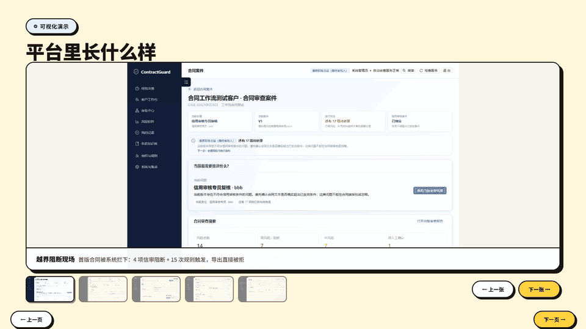
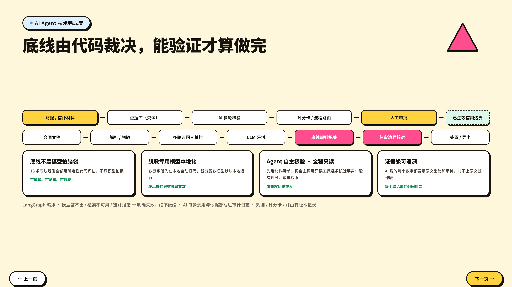
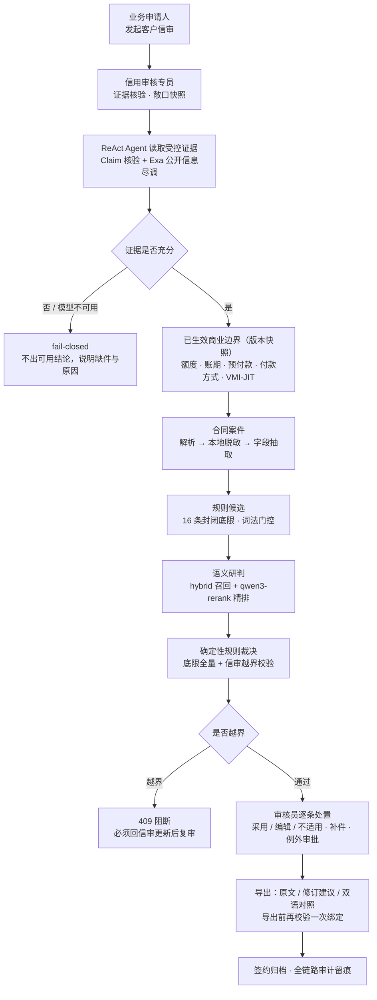

# 信盾 TrustShield

<p align="center">
  
  
  
  
  
  
</p>

> **授信先定边界，合同再审条款——越界过不去，全程有人负责。**

**信盾 TrustShield** 是面向制造企业的 AI 信审与合同风险协同工作台。创新不只是“用模型审合同”，而是让 Agent 在受控权限内自主读取证据、核验主张、形成建议、识别缺件并推动流程；在信审时还可通过 Exa 联网检索第三方企业信用报告/信评、近期诉讼/纠纷、监管信息及近期经营情况（业绩、订单、合作与重大合同）等公开信息，整理成逐条可核验的外部尽调线索。信用审核专员决定每条线索是否纳入本次判断，再把确认后的信用边界和证据包固化给合同审批使用。金额、账期、预付款、付款方式及 VMI/JIT 越界即阻断，必须回信审更新后复审，而非停留在静态风险报告。人只在核验、例外和审批节点作最终判断；每次 Agent 行动、人工决策与交接均可追溯，形成自治推进、有人兜底的闭环流程。

## 评委速览

| | |
| --- | --- |
| 🚀 本地一键启动 | `python dev.py` — 同时拉起前后端并自动打开浏览器，无需注册、无需云端 Key 即可跑通演示链路 |
| 📊 路演 PPT | [信盾-路演PPT-v2.html](./docs/03-演示与交付/信盾-路演PPT-v2.html) — 单文件离线打开，11 页含动画 |
| 📦 代码仓库 | [github.com/505260971-dotcom/trustshield](https://github.com/505260971-dotcom/trustshield) |
| 📄 交付材料 | [东江集团命题交付材料](./docs/04-交付文档/README.md) — 方案设计、脱敏样本验证、源码与部署说明 |

## 亮点数据（系统真实跑通 · 启明智造场景）

| 指标 | 数值 |
| --- | --- |
| 命题覆盖 | **12 / 12** 条全部落地 |
| 一次审查风险检出 | **19 项**（10 高 · 9 中） |
| 首版合同越界阻断 | **4 项信审阻断 + 15 次规则触发**，导出直接被拒 |
| 越界导出 | **409** 拒绝（0 放行） |
| 原文出网 | **0**（先脱敏，再出网） |

## 界面速览

<p align="center">
  
  <br/>
  <sub>全流程界面演示：信审建立商业边界 → 合同上传解析 → 风险定位与原文高亮 → 越界阻断 → 修订与导出</sub>
  <br/>
  <sub>（<a href="./docs/03-演示与交付/PPT图片导出/slide-06-可视化演示-截图-动画.gif">查看 1920×1080 高清版</a>）</sub>
</p>

<p align="center">
  
  <br/>
  <sub>AI Agent 技术完成度：命题 12 项要求逐条落地与证据对照</sub>
</p>

<!-- ===== 真实界面截图（补齐后取消注释） =====
<p align="center">
  
  
  <br/>
  <sub>左：角色工作台 —— 五个角色各管一段，待办按角色直达；右：客户信用审核 —— 额度、账期、付款方式、VMI-JIT 在此生效</sub>
</p>

<p align="center">
  
  
  <br/>
  <sub>左：越界阻断 —— 4 项信审阻断 + 15 次规则触发，导出直接被拒（409）；右：风险报告 —— 每条风险绑定原文引文与页码</sub>
</p>
===== 真实界面截图结束 ===== -->

## 目录

- [评委速览](#评委速览)
- [亮点数据](#亮点数据系统真实跑通--启明智造场景)
- [界面速览](#界面速览)
- [背景与命题](#背景与命题)
- [核心价值](#核心价值)
- [联网公开信息尽调（Agent + Exa）](#联网公开信息尽调agent--exa)
- [与其他合同问答工具的区别](#与其他合同问答工具的区别)
- [产品能力](#产品能力)
- [端到端业务流程](#端到端业务流程)
- [实现亮点（当前已落地）](#实现亮点当前已落地)
- [系统架构](#系统架构)
- [技术栈与项目结构](#技术栈与项目结构)
- [快速启动](#快速启动)
- [系统配置](#系统配置)
- [验证与测试](#验证与测试)
- [文档与演示材料](#文档与演示材料)
- [数据安全与使用边界](#数据安全与使用边界)

## 背景与命题

制造企业的合同风险通常不是孤立问题：合同金额、账期、预付款比例、付款方式、VMI/JIT 等条款，都可能突破**已经批准的客户信用边界**。传统做法是合同审核只看条款文本、忽略客户已有授信；而模型给出建议后，又无法追溯它依据了哪些材料、由谁处理、是否经过审批。

TrustShield 将两类决策拆开处理、再严格关联：

```text
客户与财务材料
        │
        ▼
客户信审：证据核验、联网公开尽调、审核专员确认
        │
        ▼
已生效的信用边界（额度 / 账期 / 最低预付款 / 付款方式 / VMI-JIT）
        │
        ▼
合同审查：文本解析、规则门控、风险处置、例外审批、修订与导出
        │
        ▼
可签约 / 退回补件 / 上报审批 / 归档审计
```
## 核心价值

1. **边界先行**：先通过信审确定客户可执行的商业边界（额度、账期、预付款、付款方式、VMI/JIT），再审查合同时逐项对照；
2. **越界不可绕过**：合同一旦突破已生效信审边界，不能通过合同端"忽略"或普通例外审批绕过——必须先更新信审、基于新版本复审；
3. **全程可审计**：Agent 的依据、人工的处置、审批的结论、导出的文档全部留痕，任何一步都可以回溯到具体材料与责任人。
4. **外部信息受控纳入**：Agent 将第三方企业信用报告/信评、近期纠纷和经营动态从“散落的网页”变为带来源链接、时间和风险归类的线索；是否影响授信由信用审核专员逐条确认，而不是由搜索结果自动决定。

## 联网公开信息尽调（Agent + Exa）

传统信审高度依赖业务上传的财报和信用报告，容易遗漏外部市场刚出现的风险信号。信盾将 Exa 的公开网页搜索能力接入信审 Agent，并发补充三类公开信息：涉诉/执行与监管风险、第三方企业信用报告与评级、近期经营情况（业绩、订单、合作、重大合同与经营动态）。系统保留标题、摘要、来源与时间；其中可识别的风险项按风险级别整理为候选线索。

这项能力的价值不只是“多搜几条新闻”，而是将公开信息放入可控的决策链：

```text
客户名称与统一社会信用主体
        ↓
Agent 联网检索公开信息（Exa）并提取标题、摘要、来源、时间与风险类型
        ↓
信用审核专员逐条确认：纳入本次评判 / 不纳入，并记录理由
        ↓
纳入项与授信条件冻结为信用版本快照
        ↓
合同审批人查看同一份已确认证据包：通过 / 退回信审 / 退回业务 / 驳回合同
```

因此，产品同时获得四类优势：

- **覆盖更全**：从内部材料扩展到第三方企业信用报告/信评、近期争议和经营变化，降低“材料看起来齐全、外部风险却被遗漏”的概率；
- **判断更快**：Agent 负责搜索、去重、摘要和初步归类，审核专员把时间集中在“是否与当前授信有关”的专业判断上；
- **责任更清**：公开网页是风险线索而非自动事实结论；每条纳入项都有来源、审核意见和确认人，能解释“为什么用了/为什么没用”；
- **后续不重复**：主管与最终审批人审合同时直接看到已纳入的信息和理由，只对合同作放行、退回或驳回决策，不再重复审批同一份信审。

联网搜索仅读取公开网页内容，不会将合同原文、财务报表或其他受控材料发送给搜索服务；搜索结果也不会自动改变评分、额度或合同状态。
## 与其他合同问答工具的区别

| 维度 | 通用合同问答/体检工具 | TrustShield |
| --- | --- | --- |
| 决策单位 | 单份合同文本 | **客户信审案件 + 合同案件**，两者强绑定 |
| 商业边界 | 不感知授信 | 信审先生效，合同后对照，越界必须回信审 |
| 模型失败时 | 常给出"可用"的降级结果 | **fail-closed**：拒绝产出建议，明确说明失败原因 |
| 证据来源 | 不可见或模糊 | 每条风险绑定原文片段、规则底线、数值依据 |
| 人工角色 | 无或单一审核 | 申请人 / 审核专员 / 审批主管 / 终审人 / 管理员 |
| 处置闭环 | 只出报告 | 补件、例外审批、修订版复审、可签约稿导出、归档 |
| 数据外发 | 不可控 | 先脱敏再出外网，翻译外发前强制校验脱敏映射 |
## 产品能力

### 1. 客户信审：先建立可执行的商业边界

- 支持新客户、存量客户、休眠客户重启及调整授信条件等场景；
- 上传财务报告、信用报告、贸易历史、申请材料和审批依据；系统保留原始材料及解析状态（上传即生成加密文本资产）；
- 维护应收、订单、逾期等**敞口快照**，作为评估依据的一部分，信审绑定合同中还会快照"审查时点"的敞口；
- ReAct Agent 在受控证据范围内多轮读取、检索和 Claim 核验；可额外调用 Exa 并发搜索公开司法/监管风险、第三方企业信用报告/评级及近期经营情况，并将每条结果保留标题、来源链接、时间、摘要与风险归类；失败或材料不足时不生成可直接使用的授信建议；
- 结合版本化评分卡、制度规则与人工审核，形成额度、账期、最低预付款、付款方式和 VMI/JIT 等信用条件；
- 信用审核专员逐条确认外部线索是否纳入，并确认授信条件后直接使信用版本生效；仅"已生效"版本可成为合同审查边界。

### 2. 合同审查：RAG + ReAct Agent，规则门控与人工协同并行

- 支持 DOCX、PDF、XLSX、TXT、PNG/JPG/WEBP/BMP 等合同及关联材料（扫描件走本机 OCR）；
- 本地脱敏后进行结构化解析、字段提取，再由 **RAG + ReAct 合同审查 Agent** 自主检索条款（hybrid recall + qwen3-rerank）、读取上下文、核对 16 条底限规则目录与客户已批准授信边界，提交带原文引文的 Claim，经确定性校验后由规则引擎裁决；
- 确定性本地规则仍覆盖每一条款作为兜底，Agent 不可用时安全失败、不降级为词法猜测；
- 同时检查合同是否突破已绑定信审的额度、账期、收款比例或付款方式；信审越界不能通过合同端"忽略"或普通例外审批绕过；
- 以案件管理主合同、附件、修订版、当前版本、历史版本、责任人、待办与流程记录；
- 审核员可逐条处置风险：采用建议、编辑后采用、确认不适用；所有理由保留在审计链路中；
- 支持待补材料、条款例外审批、版本对比、增量复审及原文/修订建议/双语 Word 导出。

### 3. 面向不同角色的工作台

系统不要求所有人阅读同一份复杂报告，而是将真实待办按角色组织：

| 角色 | 主要目标 | 典型操作 |
| --- | --- | --- |
| 业务申请人 | 完整提交业务背景与材料，响应退回意见 | 发起信审、发起合同、补件、上传修订版、查看进度 |
| 信用审核专员 | 核验证据、确认信用结论、决定外部线索是否纳入 | 运行评估、逐条确认联网线索、确认/修订授信条件；确认后信用版本直接生效 |
| 财务审批主管 | 审合同的商业可接受性，处理合同退回与驳回 | 查看已确认信审与联网证据包、批准合同、退回信审/业务、驳回合同 |
| 最终审批人 | 对需终审合同作最终商业决策 | 查看完整审计依据、终审批准、退回、驳回合同 |
| 系统管理员 | 治理组织、规则和模型配置 | 用户管理、合同规则版本发布、模型连通性测试与审计查看 |

当前工作台将"角色职责 → 处理路径 → 当前优先事项 → 下一责任人"放在首屏。审批中心和案件详情优先呈现申请/建议差异、未完成门禁和动作后的流转结果，避免用户先在多个标签页中寻找关键结论。

### 4. 聚焦的合同报告工作区

合同报告的默认风险工作区专为连续审核设计：

- 左侧：按待处置优先级排序的问题条款导航；
- 中间：当前条款原文与命中证据高亮；
- 下方：规则底线、证据、修改建议、数值依据和真实处置入口；
- 支持上一条/下一条连续处理，风险处置仍复用案件接口和审计记录；
- 对信审越界风险明确提示必须更新信审后复审合同，不能在合同端放行。
## 端到端业务流程

### 信审流程

1. 业务人员发起客户信审，补充客户、业务类型、申请条件和材料；
2. 信用审核专员维护敞口快照，启动量化评估；
3. Agent 读取受控证据、提取 Claim、执行制度与评分核验；同时可联网并发检索公开司法/监管风险、第三方企业信用报告/评级及近期经营情况，产生带来源的候选线索和参考来源；
4. 信用审核专员确认或修订建议，逐条决定外部线索是否纳入，并记录人工判断依据；
5. 信用审核专员确认后，信用版本直接生效；
6. 生效后的信审版本及其已纳入外部证据包成为合同可消费的商业边界；主管和最终审批人在合同审批阶段可查看、退回或驳回合同。

### 合同流程

1. 业务人员选择客户，系统查询真实有效信审并关联；
2. 填写合同业务信息，上传主合同和可选附件；
3. 系统创建案件并执行解析、脱敏、规则校验、LLM 研判与信审边界核对；
4. 审核员在合同报告中定位风险、查看证据、处理修改建议或发起补件/例外审批；
5. 案件门禁全部闭环后，审核员确认可签；有分级风险时进入主管或最终审批；
6. 修订版合同重新审查后成为当前版本；历史版本仅用于对比和审计；
7. 导出原文留档、修订建议稿或双语对照稿，并完成签约归档。
## 实现亮点（当前已落地）

以下为当前代码中已实际实现并可通过回归脚本验证的能力。

### 1. 信审与合同强绑定，越界条款不可绕过

- 合同案件创建时按客户查询真实有效信审：唯一版本自动关联，多版本默认推荐最新有效版本，业务可确认或切换；
- 合同上传与**导出可签约稿前**都会校验绑定关系与 `CREDIT_*` 阻断项（`main.py` 导出接口对未闭环的信用越界直接返回 409），不存在"合同端悄悄放行"的路径；
- 合同报告内对信审越界风险明确提示：须先更新信审并基于新版本复审。

### 2. 确定性规则门控，底线条款不依赖模型"感觉"

- 账期、交货期、合同有效期、VMI/JIT、间接损失、供货方责任等**底线规则用确定性代码评估**（`services/deterministic_rules.py`），可解释、可单测、可回归（`test_deterministic_rules.py`）；
- 架构上是"LLM 负责候选召回与建议文本，底线是否符合由确定性代码裁决"，避免模型幻觉直接决定可签约性；
- 合同底线规则以**版本化规则目录**管理，可草稿、修改、发布，审查时按版本快照执行。

### 3. 全程脱敏后再出外网，翻译外发前强制校验

- 合同上传后立即脱敏：电话、邮箱、身份证、银行账号、金额、公司名、图号、联系人等按模式替换为占位符（`services/mask.py`），可再叠加可选 LLM 深度脱敏（`services/smart_mask.py`）；
- 脱敏映射加密持久化，报告与译文全程携带占位符，仅在导出留档时恢复；
- 翻译路由在**找不到脱敏映射时直接拒绝（409）**，确保原文绝不外发（`test_translation_privacy.py` 覆盖该行为）。

### 4. 信审 ReAct Agent：证据核验、失败即拒

- 财报、信用报告、贸易历史等材料在**受控证据范围**内多轮读取、检索、Claim 核验（`services/credit_react_agent.py`）；
- 工具调用有步数上限（默认 16 步），超限 **fail-closed**：材料不足或核验失败时不产出可直接使用的授信建议，而是给出明确的补件/失败原因；
- 每一步 action、tool_result、claim_validated 都实时推送到界面并可审计，评估报告加密落库；
- 评分卡同样**版本化管理**；每个生效信用版本会冻结审核专员确认的授信条件与已纳入的外部证据，便于复核与追溯。

### 4.1 Agent 联网公开尽调：扩大证据覆盖，不转移决策责任

- 信审 Agent 可通过 Exa MCP 调用 `web_search_exa` 并发检索客户企业的司法/监管风险、第三方企业信用报告/评级及近期经营情况等公开信息，并以标题、来源 URL、发布时间/摘要、类别和严重程度组织为候选线索或参考来源；
- 搜索结果进入审核专员的逐条确认工作台：只有被明确标为“纳入本次评判”的条目才会写入信用版本与合同审查报告；不纳入项保留在信审审计轨迹中，避免“看过但无处说明”；
- 主管和最终审批人可在合同审批时查看同一份已纳入证据包，并选择批准、退回信审专员、退回业务补件或驳回合同，而不再重复批准信用结论；
- 搜索工具只接收检索关键词和公开网页 URL，不传递合同原文、财务材料、信用报告或内部评分；Agent 无权自动调整额度、账期或审批状态。

### 5. 召回链路：词法 → RRF 融合 → 精排，且"安全失败"

- 证据检索 = 受控词法候选召回 →（可选 Embedding 后做 RRF 融合）→ qwen3-rerank 精排；
- 关键设计：**rerank 未就绪时正式依据检索安全失败**，不会悄悄降级为纯词法排序（"看着有依据、其实没检索"的情况被杜绝），并在就绪接口中明确提示缺少哪项配置；
- 财务证据是否允许外发到 Embedding / 重排服务，由独立开关授权（`rerank_allow_remote_financial_data` 等），默认预填阿里百炼配置并开启授权；填入 API Key 前不会发生任何外发；
- **外发前强制脱敏，无法绕过**：任何发往外部服务的证据文本（词法召回、Embedding 向量化、Rerank 精排、财务模型提取）都必须是本地脱敏网关（正则 + 本地 LLM，默认本地 Ollama）掩码后的文本；未配置可用的脱敏模型时，正式检索与提取安全失败（`evidence_mask_unavailable`），不会以原文兜底。模型看到的占位符由系统在本地还原校验，报告与引文仍展示原文。

### 6. 实时流式进度 + 原文证据对照

- 合同审查、信审评估、翻译均以 **SSE** 流式推送步骤与事件，浏览器端实时展示"当前在处理什么"；
- 每一条风险都绑定 `source_ref / page / evidence_quote`，报告页支持原文高亮对照，证据与结论同时可见（`/stream`、`/preview`、信审 live_evidence 事件）。

### 7. 三层权限校验 + 案件级数据隔离

- 角色、接口、案件动作**三层校验**（`auth.py` 的 `require(...)` 与 `current_user`），前端角色视图不替代后端授权；
- 业务申请人只能访问自己创建的案件，越权访问返回 **404 而非 403**（不泄露案件是否存在）；
- 数据隔离到案件级：合同案件与信审案件互相以 ID 关联，业务人员无法浏览企业级授信台账。

### 8. 加密存储 + 全量审计留痕

- 敏感报告、脱敏映射使用 **Fernet 加密**后落库（`cryptography`），`backend/data/config.json` 只存模型运行配置；
- 模型 API Key 在管理员界面维护，加密存储、页面只显示"已配置"状态；
- 创建、审批、处置、导出、下载、预览等几乎所有业务动作都写入审计日志（`store.audit`），可导出追溯。

### 9. 版本化治理：规则、信用版本、合同版本

- 合同底线规则版本：草稿 → 发布 → 生效快照，审查按版本执行；信用版本冻结审核专员确认的授信条件与已纳入外部证据；
- 合同支持主合同/附件/修订版，**历史版本对比**（`/compare`）与**增量复审**（仅重审变化条款）；
- 文档解析器带版本号（`PARSER_VERSION`），解析格式演进可追溯、可迁移。

### 10. 可交付文档：修订稿 / 原文留档 / 双语对照

- 一键导出 Word：**修订建议稿**（含已采纳的修改建议）、**原文留档版**、**双语对照稿**（中 ↔ 英/越/日/西）；
- 导出前强制校验：信审绑定有效、`CREDIT_*` 阻断项已闭环、例外审批全部完成——未闭环的内容不会进入可签约稿；
- 导出快照入档（`record_export_snapshot`），谁在什么状态下导出了哪一版，全程可查。

### 11. 企业集成 Mock + 客户工作台

- **CRM 接入端口**：接收客户主数据并可选创建信审草稿（不执行授信测算），模拟"ERP/CRM 推送 → 信审 → 合同"完整链路；
- **泛微 OA 审批流模拟**：合同风险结论可推送为流程，按角色流转、批量采纳修改建议；
- **客户工作台**：展示授信额度占用，支持"模拟下单"测算可用额度（headroom simulate）——让评审现场可直观解释"为什么这笔合同会越界"；
- 批量矩阵（batch-matrix）支持按客户/条款维度汇总多份合同的待办与风险分布。
## 系统架构

### 双链路与门控（一张图看完）



> 三条硬约束体现在图上：**边界先于合同**（E 在 F 之前）、**模型不可用即失败而非降级**（C2）、**越界不能从合同端绕过**（K）。

### 部署形态

```text
┌──────────────────────────────────────────────────────────────┐
│ React + TypeScript + Ant Design                               │
│ 工作台 / 客户工作台 / 信审 / 合同案件 / 审批 / 规则与设置      │
└───────────────────────────────┬──────────────────────────────┘
                                │ HTTP + SSE 流式状态查询
┌───────────────────────────────▼──────────────────────────────┐
│ FastAPI                                                        │
│ 认证与权限 · 案件状态机 · 文件与版本 · 审批 · 审计 · 导出      │
└───────────────┬──────────────────────────┬───────────────────┘
                │                          │
┌───────────────▼──────────────┐ ┌─────────▼───────────────────┐
│ 合同审查链路                  │ │ 信审评估链路                │
│ 解析 → 脱敏 → 候选召回       │ │ ReAct 证据 Claim 核验       │
│ → LLM 研判 → 确定性规则      │ │ → 评分卡 / 专员确认 → 生效 │
│ → 风险、补件、例外、导出     │ │                             │
└──────────────────────────────┘ └─────────────────────────────┘
```

**组件说明：**

- 前端（`frontend/`）：Vite + React 19 + Ant Design，页面含工作台、客户工作台、信审、案件中心、案件详情（报告工作区）、审批中心、批量矩阵、知识库、系统设置；
- 后端（`backend/app/`）：FastAPI 提供 REST API；`graph/review_graph.py`（LangGraph 编排合同审查链路）、`graph/credit_graph.py`（信审评估）、`services/`（解析、脱敏、规则、数值提取、召回/重排、翻译、导出、CRM/OA 集成）；
- 存储：SQLite（`backend/data/contractguard.db`，敏感字段 Fernet 加密）+ `backend/data/config.json`（模型运行配置）+ `backend/data/uploads/`（原始材料与导出文件）；
- 前端 `/api` 由 Vite 代理到后端；生产模式下后端直接托管 `frontend/dist` 构建产物（单服务部署）。

有关组件边界、数据流和企业定制项，参见 [系统架构说明](./docs/01-产品与架构/architecture.md) 与 [企业定制项对照](./docs/01-产品与架构/enterprise-customization.md)。
## 技术栈与项目结构

- 前端：React 19、TypeScript、Vite、Ant Design 6、@ant-design/charts、dayjs；
- 后端：Python 3.11+、FastAPI、LangGraph、Pydantic、uvicorn、python-docx、pdfplumber、openpyxl、cryptography(Fernet)、PyJWT、pytesseract(OCR)；
- 模型能力：主合同审查模型、财报 ReAct 专用模型、可选 Embedding 召回、必选 qwen3-rerank 精排、可选智能脱敏模型；均通过管理员设置管理，不写死在代码中；
- 支持能力：规则版本、信用版本快照、Exa 联网公开信息尽调、CRM Mock、泛微 OA Mock、多语言翻译（中/英/越/日/西）、Word 导出、审计日志、SSE 流式进度。

```text
.
├─ backend/
│  ├─ app/
│  │  ├─ main.py              # FastAPI 入口与全部路由
│  │  ├─ graph/               # LangGraph 编排：review_graph / credit_graph
│  │  ├─ services/            # 解析、脱敏、规则、召回、翻译、导出、集成
│  │  ├─ auth.py / config.py / store.py
│  ├─ scripts/                # 可独立运行的回归/验收脚本
│  ├─ data/                   # 运行期数据（config.json、SQLite、uploads；不入库）
│  ├─ .env.example            # 启动级安全参数模板
│  └─ requirements.txt
├─ frontend/
│  ├─ src/pages/              # 工作台、信审、合同、审批和治理页面
│  ├─ src/components/         # 报告、工作流、翻译等可复用组件
│  └─ package.json
├─ docs/                       # 产品、架构、接口、演示与验收材料
├─ runtime/                    # 本地运行期目录（日志、演示合同；不提交业务数据）
└─ dev.py                     # 跨平台开发服务器（一条命令启动前后端）
```
## 快速启动

### 前置条件

- Python 3.11+
- Node.js LTS 与 npm（内置 node 命令）

### 1. 配置启动级安全参数

```bash
cd trustshield
cp backend/.env.example backend/.env   # Windows CMD: copy backend\.env.example backend\.env
```

在 `backend/.env` 中至少填写：

```dotenv
AUTH_SECRET=请替换为随机长字符串
DATA_ENCRYPTION_KEY=请替换为Fernet密钥
INITIAL_ADMIN_USERNAME=admin
INITIAL_ADMIN_PASSWORD=请替换为强密码
INITIAL_ADMIN_NAME=系统管理员
```

生成 Fernet 密钥：

```bash
python -c "from cryptography.fernet import Fernet; print(Fernet.generate_key().decode())"
```

> 首次启动时，系统依据 `INITIAL_ADMIN_*` 自动创建初始管理员；模型地址、模型名、API Key 不进 `.env`，而是登录后在"系统与集成"页面维护（加密存储）。

### 2. 安装依赖

```bash
cd backend && python -m pip install -r requirements.txt
cd ../frontend && npm install
cd ..
```

> 扫描件 OCR 需另行安装 Tesseract 及中文语言包，并在 `backend/.env` 中配置 `TESSERACT_CMD`（Windows）或加入 PATH（macOS/Linux）；未安装时不影响常规 DOCX/PDF 文本合同。

### 3. 一条命令启动开发服务器

```bash
python dev.py
```

`dev.py` 是跨平台开发服务器（Windows / macOS / Linux 均可，无需 PowerShell），它会：

- 启动后端 `uvicorn --reload`（代码改动自动重载）；
- 启动前端 Vite（HMR 热更新，`/api` 自动代理到后端）；
- 前后端日志统一输出到当前终端（带 `[backend]` / `[frontend]` 前缀）；
- 等待后端就绪后自动打开浏览器；按 `Ctrl+C` 一键停止前后端；
- 端口被占用时自动跳过对应服务的重复启动。

常用参数：

| 参数 | 说明 | 示例 |
| --- | --- | --- |
| `--no-browser` | 启动服务但不自动打开浏览器 | `python dev.py --no-browser` |
| `--port` | 自定义前端端口 | `python dev.py --port 5174` |
| `--backend-port` | 自定义后端端口 | `python dev.py --backend-port 8001` |

默认地址：

- 前端：`http://127.0.0.1:5173`
- 后端健康检查：`http://127.0.0.1:8000/api/health`
- 后端接口文档（Swagger UI）：`http://127.0.0.1:8000/docs`

### 4. 分开启动（可选）

如果需要分别观察两端日志，也可以在两个终端分别执行：

```bash
# 终端 1：后端
cd backend && python -m uvicorn app.main:app --reload --port 8000

# 终端 2：前端
cd frontend && npm run dev
```

### 5. 生产模式预览（可选）

构建前端后，后端会直接托管构建产物（单服务部署）：

```bash
cd frontend && npm run build
cd ../backend && python -m uvicorn app.main:app --port 8000
```

然后访问 `http://127.0.0.1:8000` 即可（无需另起前端）。
## 系统配置

### 模型与检索

首次启动后，以管理员身份进入"系统与集成"维护：

- 主合同审查模型；
- 财报 ReAct 专用模型；
- Exa MCP 公开信息检索（无需业务侧维护搜索 API Key）；
- 合同脱敏模型（可选智能脱敏）；
- Embedding 服务、重排服务及密钥；
- 财务证据可否按合规授权发送到外部模型服务。

管理员页面支持连通性测试。模型地址、模型名和 API Key 保存于 `backend/data/config.json`，页面仅显示"已配置"状态；该文件必须位于受限目录，且不应提交到 Git。

对于百炼 Compatible API，当前项目按官方兼容接口使用 `/embeddings` 与 `/reranks` 路径。Embedding 仅帮助候选证据召回，不会单独产生事实、评分或授信审批结论。

### 权限与规则治理

- 启动管理员由 `INITIAL_ADMIN_*` 环境变量创建；正式环境必须修改默认密码；
- 管理员可创建、编辑、发布合同规则版本；信用审核由信用审核专员确认后直接生效，管理员不配置重复的信审审批路径；
- 系统对合同底线规则采用**确定性门控**，而不是对固定、封闭的规则集进行 per-clause 向量 RAG；
- 系统在角色、接口与案件动作三个层面校验权限，前端角色视图不替代后端授权。
## 验证与测试

### 前端构建与静态检查

```bash
cd frontend
npm run build
npm run lint
```

### 后端关键回归

```bash
cd backend
python scripts/test_security_workflow.py
python scripts/test_context_budget.py
python scripts/test_mask_fast_path.py
python scripts/test_credit_contract_guard.py
python scripts/test_credit_react_agent.py
```

`backend/scripts/` 中还可按改动范围选择执行：

- **解析与规则**：`test_document_ingest.py`、`test_annual_report_extract.py`、`test_deterministic_rules.py`、`test_rule_catalog.py`；
- **信审链路**：`test_credit_assessment.py`、`test_credit_audit_agent.py`、`test_credit_e2e.py`、`test_credit_production_graph.py`、`test_credit_reviewer_flow.py`、`test_external_due_diligence.py`、`test_financial_llm_extraction.py`、`test_credit_embedding_recall.py`；
- **合同链路**：`test_contract_workflow.py`、`test_incremental_review.py`、`test_translation_privacy.py`；
- **治理与安全**：`test_admin_user_management.py`、`test_security_workflow.py`、`validate.py`。
## 文档与演示材料

完整资料索引见 [docs/README.md](./docs/README.md)。建议阅读顺序：

1. [系统架构说明](./docs/01-产品与架构/architecture.md)
2. [企业定制项对照](./docs/01-产品与架构/enterprise-customization.md)
3. [接口契约](./docs/02-接口与验收/api-contract.md)
4. [合同评审验收基线](./docs/02-接口与验收/contract-review-baseline.md)
5. [启明智造场景材料包](./docs/03-演示与交付/模拟测试材料-v2-启明智造场景/README.md)
6. [启明智造逐步演练手册](./docs/03-演示与交付/模拟测试材料-v2-启明智造场景/08-逐步演练手册.md)
7. [路演 PPT（单文件，浏览器即开）](./docs/03-演示与交付/信盾-路演PPT-v2.html)
8. [东江集团命题交付材料（方案设计、脱敏样本验证、源码与部署说明）](./docs/04-交付文档/README.md)
## 数据安全与使用边界

- 合同与财务材料属于高敏业务数据；示例数据和命题材料仅限本项目/赛事开发与验证使用；
- 原始数据、解析文本、运行配置和导出文件应放在受控目录，设置适当的文件系统权限；
- `backend/.env`、`backend/data/`（含 `config.json`、SQLite、上传附件）与 `runtime/` 不得提交到公开仓库（已在 `.gitignore` 中排除）；
- 脱敏、受控证据、人工复核、确定性规则和审计留痕共同构成系统的安全边界；**模型输出不能绕过已生效信审和审批规则**；
- 联网公开信息是辅助尽调线索，不构成自动授信或自动拒绝依据；是否纳入、如何影响信用条件均由信用审核专员确认，并在审计链路中留痕；
- 模型 API Key 加密存储，页面只显示"已配置"状态；财务数据外发（Embedding/重排）默认关闭，需管理员显式授权。

---

如需了解具体接口、部署边界或验收标准，请从 [docs/README.md](./docs/README.md) 开始。
